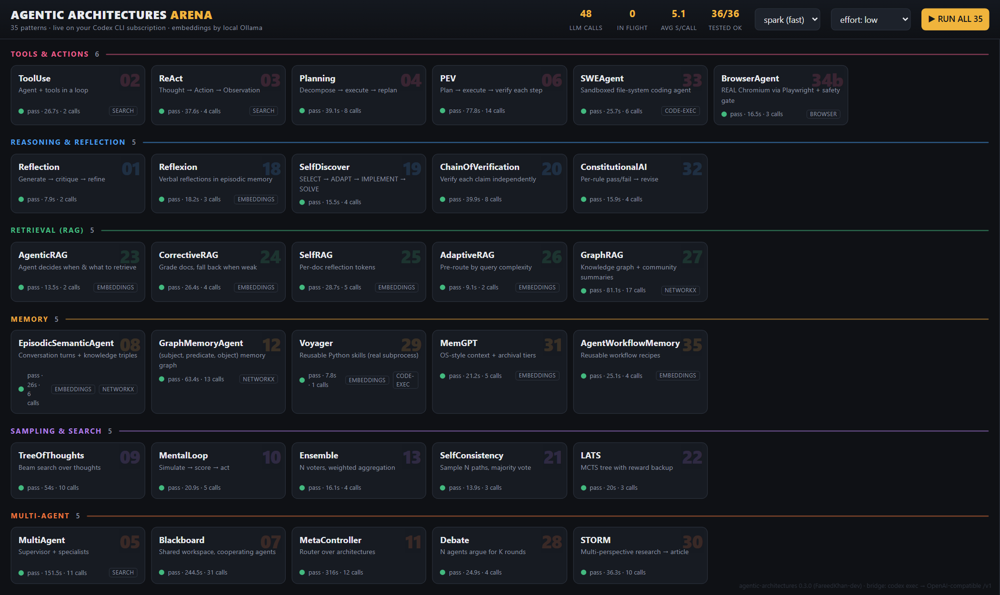
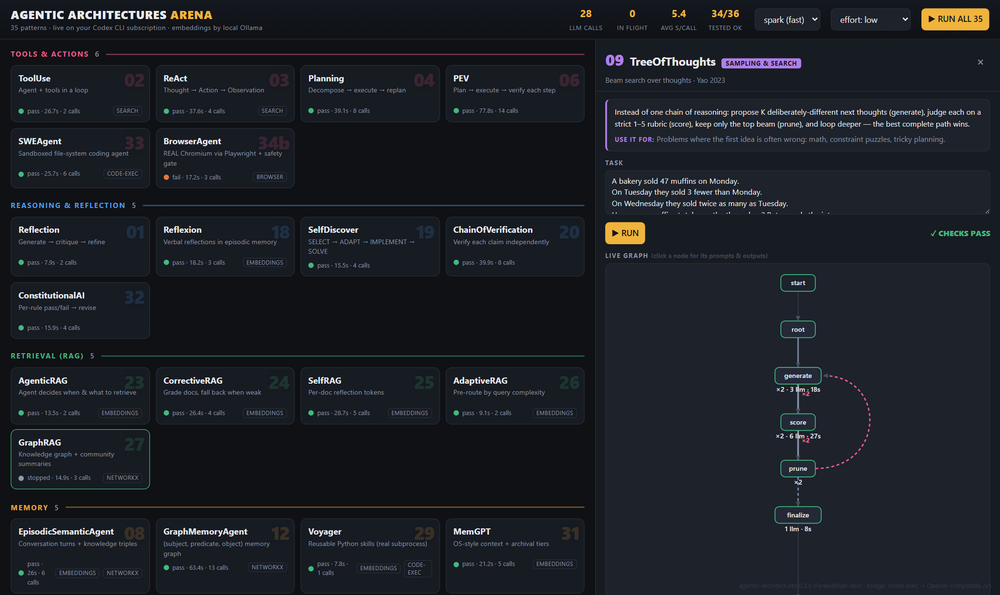
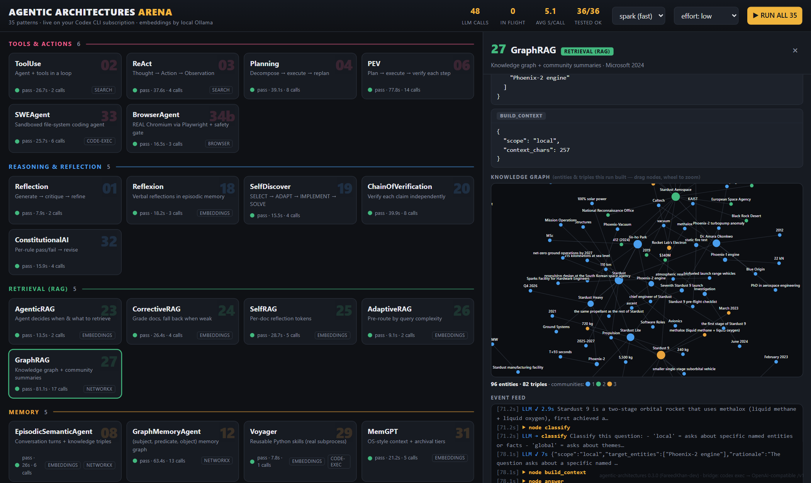

# Agentic Architectures Arena

**Run all 35 agentic AI design patterns on your ChatGPT subscription — no API keys — behind a clickable teaching dashboard.**

Click a pattern → read a plain-English explainer of what it actually does → hit RUN → watch its **real LangGraph light up node-by-node** while every LLM call streams into a live feed → click any node to inspect the exact prompts and responses → see the knowledge graph or shared workspace the agents built.

## 📺 The video this was built for

[](https://www.youtube.com/watch?v=PZsJfBVDZZc)

**▶ [Learn Every AI Agent Pattern From One Video (I Actually Ran All 35)](https://www.youtube.com/watch?v=PZsJfBVDZZc)** — [The AI Automators](https://www.youtube.com/@TheAiAutomators) · 36 min

This repo was created as part of that video. In it we walk all 35 patterns across 8 families, and every single one runs **live on screen in this Arena** — real model calls, real LangGraph topologies lighting up node by node — so you can watch the shape of each architecture execute instead of just reading about it. Everything you see in the video is in here; install it below and run the same patterns yourself.

Built by [The AI Automators](https://www.theaiautomators.com/). The pattern implementations come from [**FareedKhan-dev/all-agentic-architectures**](https://github.com/FareedKhan-dev/all-agentic-architectures) — this repo is a teaching harness around that excellent library (see [How this uses the base repo](#how-this-uses-the-base-repo)).



| Live annotated graph + explainer (Tree of Thoughts) | Knowledge-graph viewer (GraphRAG) |
|---|---|
|  |  |

## What makes it interesting

- **$0 API spend.** LLM calls are served by an OpenAI-compatible bridge that shells out to the **OpenAI Codex CLI** — each call runs on the ChatGPT plan you already pay for. Embeddings run locally via **Ollama**. Web-search tools use Codex's built-in search (no Tavily key).
- **The graphs teach.** Every card shows its pattern's real compiled LangGraph up-front. During a run, nodes pulse and accumulate badges (`×visits · N llm calls · seconds`), loop edges thicken with a `×count`, and self-loops render as real loops — so Blackboard's "3 nodes" visibly explain a 31-call run.
- **Full transparency.** Click any node for every prompt/response that happened inside it (role-labelled, JSON pretty-printed). Memory/RAG patterns get an interactive **knowledge-graph viewer** (drag, zoom, communities coloured). Blackboard/Voyager/AWM/MemGPT get a **workspace viewer** (board contributions, LLM-written skills with the actual code, mined recipes, in-context memory).
- **Honest scoring.** Each pattern ships with a benchmark task and PASS/FAIL checks from the base repo's own suite. RUN ALL sweeps every pattern (~6 min, ~200 LLM calls) into a green/red board.

## Requirements

| Requirement | Notes |
|---|---|
| **Python 3.10–3.13** (3.12 tested) | `python --version` — 3.14+ is blocked by setup until wheels catch up |
| **git** | used to clone the base library |
| **[OpenAI Codex CLI](https://developers.openai.com/codex/cli)** logged in with a ChatGPT plan | `npm i -g @openai/codex` (or the standalone installer), then `codex login`. Tested with codex-cli **0.144.x** — the bridge uses `--output-schema`, `--ephemeral`, `--ignore-user-config`, `-o`, `-s read-only`, `--skip-git-repo-check` and `-c tools.web_search=true`; if a future codex changes these, install 0.144. |
| **[Ollama](https://ollama.com)** running locally | needed by the 9 RAG/memory patterns for embeddings (the other 27 work without it). Setup pulls the small `nomic-embed-text` model (~270 MB). |
| OS | Windows 10/11, macOS, or Linux. Tested end-to-end on Windows 11; macOS/Linux use `setup.py` + `start.sh`. |
| Disk / network | ~2 GB for the venv + Chromium; first setup downloads packages. |

> **Cost note:** runs consume your ChatGPT plan's Codex usage (a full 36-pattern sweep ≈ 200 requests). No per-token API billing anywhere.

## Install

```bash
git clone https://github.com/theaiautomators/agentic-architectures
cd agentic-architectures
python setup.py
```

(`python3 setup.py` on macOS/Linux; `py setup.py` if `python` isn't on PATH on Windows. Add `--no-browser` to skip the ~130 MB Chromium download — only the BrowserAgent card needs it.)

Setup checks your prerequisites, clones the base library into `arena/` at a pinned commit, applies our teaching patches, builds `.venv`, and pulls the embedding model. It prints `[FAIL]` / `[warn]` lines telling you exactly what to fix; it is safe to re-run.

**Start the dashboard:**

- **Windows:** double-click `Start-Arena.bat`
- **macOS/Linux:** `./start.sh` (already executable from a git clone; `chmod +x start.sh` only if you downloaded a ZIP)

Your browser opens `http://127.0.0.1:8035/`. Click a card, hit **▶ RUN**, and watch. A different port: set `ARENA_PORT` before starting.

## Using the Arena

- **Cards** — 36 runnable classes covering the 35 numbered patterns (#34 ships twice: the ComputerUse mock and the real-Chromium BrowserAgent), grouped into 8 families. The dot shows the last result.
- **Drawer** — explainer ("what's actually happening" + "use it for"), editable task, RUN/STOP, live graph, event feed, output, metadata chips, verdict.
- **Node inspector** — click any graph node for its full prompts/responses/tool calls.
- **Knowledge graph** — appears after runs of GraphMemoryAgent / GraphRAG / EpisodicSemanticAgent: every entity + predicate-labelled triple the run built. Drag nodes, wheel-zoom, hover edges.
- **Workspace** — appears for Blackboard (who wrote what, per round), Voyager (LLM-written Python skills — really executed), AgentWorkflowMemory (mined recipes), MemGPT (the in-context tier).
- **RUN ALL 35** — full sweep with a status-light strip; results persist under `results/` and survive restarts. `dashboard/make_summary.py` writes a Markdown leaderboard.
- **Model/effort selectors** — `spark (fast)` is the default; switch to `sol (smart)` + higher effort for harder tasks.
- **Staged failure demos** — every default task is fitted to what its pattern is FOR, so a full sweep can go green. To show a pattern failing on the *wrong* job (the repo documents these), paste a misfit task: ask Reflexion or AgentWorkflowMemory `What is my favourite colour?` after a setup of `Remember: my favourite colour is teal`, or give Ensemble the Sally-sisters trick.

## How it works

```
Browser UI  ──SSE──  FastAPI (dashboard/server.py, :8035)
                       ├─ /api/*  runs, sweeps, state, graphs   (arena_runner.py)
                       ├─ /v1/*   OpenAI-compatible bridge      (codex_shim.py)
                       │            chat/completions → one `codex exec` subprocess per call
                       │            (--output-schema for structured output; tool-calls emulated)
                       ├─ /v1/embeddings → local Ollama
                       └─ /tools/web_search → codex exec with web search enabled
        arena/  = FareedKhan's library (cloned by setup, pinned) + our overrides
```

The library is pointed at the bridge purely via environment (`LLM_PROVIDER=openai`, `OPENAI_BASE_URL=http://127.0.0.1:8035/v1`) — the same shim works for any OpenAI-compatible tool. Live node events come from a LangChain callback hook that tags every nested LLM/tool call with its LangGraph node.

## How this uses the base repo

[FareedKhan-dev/all-agentic-architectures](https://github.com/FareedKhan-dev/all-agentic-architectures) (MIT) provides all 35 pattern implementations, the benchmark tasks, and the sample corpus. `setup.py` clones it into `arena/` at pinned commit `cf9d620` and then copies **five teaching patches** from `overrides/` on top. Nothing else is modified; behaviour and metadata are unchanged.

| File | What we changed | Why |
|---|---|---|
| `tree_of_thoughts.py` | split the fused `expand` node into `generate` → `score` | the graph now shows the canonical propose-vs-judge loop |
| `lats.py` | split the single `iterate` node into `select` → `expand` → `evaluate` → `backup` | the graph now teaches the MCTS cycle |
| `episodic_semantic.py` | replaced a one-node stub graph with the real `retrieve` → `answer` → `extract` → `record` pipeline | the dual-memory write-back loop is the whole lesson |
| `graph_memory.py` | replaced a one-node stub graph with `retrieve` → `answer` | honest topology for the graph-walk pattern |
| `graph_rag.py` | entity resolution (exact, then containment) before local fact lookup | "Phoenix-2 engine" (classifier) now matches "Phoenix-2" (graph node) |

## Configuration (env vars, all optional)

| Var | Default | Meaning |
|---|---|---|
| `ARENA_PORT` | `8035` | dashboard + bridge port |
| `ARENA_CODEX_MODEL` | `gpt-5.3-codex-spark` | codex model for LLM calls |
| `ARENA_CODEX_EFFORT` | `low` | reasoning effort (`none/low/medium/high/xhigh`) |
| `ARENA_CODEX_CONCURRENCY` | `4` | parallel codex subprocesses |
| `ARENA_CODEX_TIMEOUT` | `300` | seconds per LLM call |
| `ARENA_EMBED_MODEL` | `nomic-embed-text` | Ollama embedding model |
| `ARENA_SWEEP_PARALLEL` | `3` | patterns run in parallel during RUN ALL |
| `ARENA_CODEX_EXE` | auto-discovered | explicit path to the codex executable if discovery picks wrong |

## Troubleshooting

- **`codex` not found / not logged in** — install the Codex CLI and run `codex login` (browser sign-in with your ChatGPT account). The header of `Start-Arena.bat` / `start.sh` warns if you're logged out.
- **RAG/memory cards error with connection refused on :11434** — Ollama isn't running. Start Ollama, then `ollama pull nomic-embed-text` (setup does this when Ollama is up).
- **BrowserAgent errors about Playwright** — you skipped the browser install. Run `.venv/bin/python -m playwright install chromium` (Windows: `.venv\Scripts\python -m playwright install chromium`). On Linux, missing system libraries need `sudo .venv/bin/python -m playwright install-deps chromium` as well.
- **Every run 500s with `codex bridge failure`** — the bridge couldn't invoke codex. Check `codex login status` in a terminal; if codex works there but the Arena still fails, point the bridge at it explicitly: set `ARENA_CODEX_EXE` to the full path of your codex executable and restart.
- **Port 8035 busy** — the launchers try to free it (netstat/taskkill on Windows, lsof/kill where available); otherwise set `ARENA_PORT`.
- **Leaderboard file** — after a sweep: `.venv\Scripts\python dashboard\make_summary.py` (mac/linux: `.venv/bin/python dashboard/make_summary.py`) writes `results/SWEEP.md`.
- **Runs feel slow** — each LLM call is a fresh `codex exec` (~3–7 s at spark/low). That's the trade for $0 API spend. Reduce with lower-call patterns or keep effort at `low`.
- **A run fails its checks** — that's a real model answer failing the benchmark check, not a crash. Hit RUN again, raise effort, or read the node inspector to see exactly where it went sideways.
- **Stale-looking UI after pulling an update** — hard-refresh once; the server sends `no-store` so assets shouldn't cache, but an old tab from a previous server can linger.

## Safety notes

Everything binds to `127.0.0.1` only. Three patterns touch your machine by design, exactly as in the base repo: **Voyager** and **SWEAgent** execute LLM-written Python locally (isolated interpreter, 5–10 s timeouts, sandboxed working dirs under `.sandbox/`), and **BrowserAgent** drives a real headless Chromium with a domain blocklist. The codex bridge itself runs every call sandboxed read-only with your user Codex config ignored. Don't expose the port publicly.

## Credits

- **[Fareed Khan](https://github.com/FareedKhan-dev)** — the 35 pattern implementations this whole thing runs on. Go star the base repo.
- **[The AI Automators](https://www.theaiautomators.com/)** — dashboard, Codex bridge, teaching patches. MIT, see [LICENSE](LICENSE).
